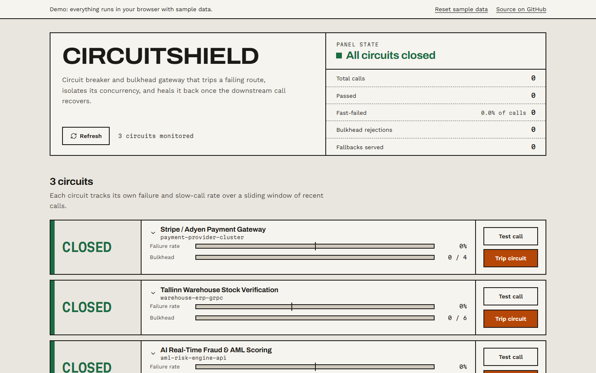
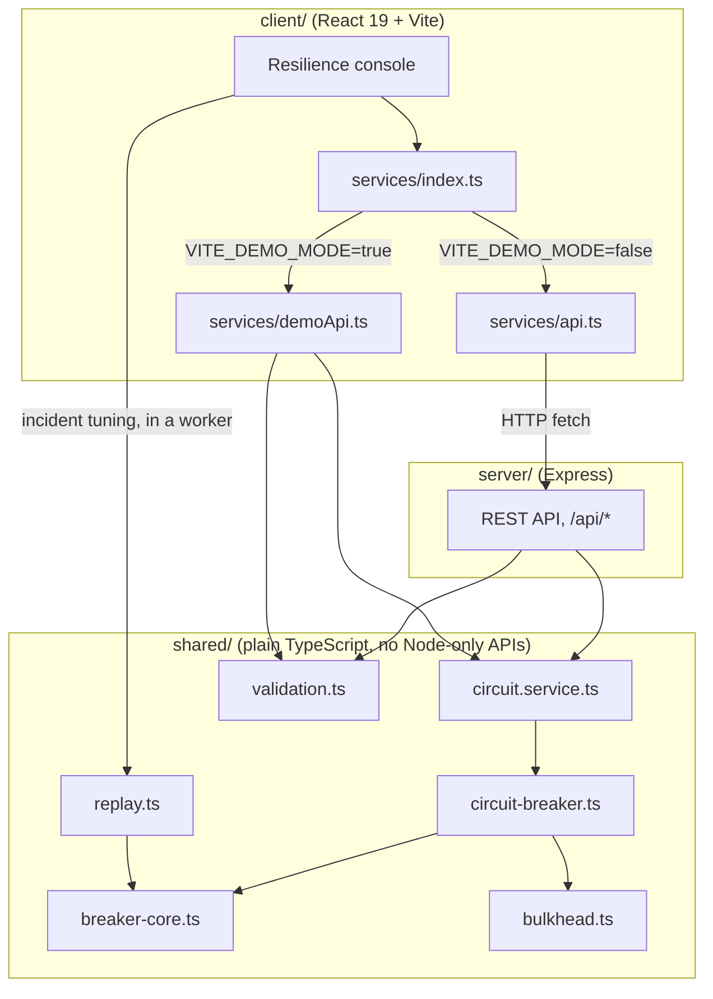

# CircuitShield

CircuitShield is a circuit breaker and bulkhead isolation gateway: an Express API that protects a downstream
call behind a three-state breaker (`CLOSED` / `OPEN` / `HALF_OPEN`) and a per-route concurrency limiter, plus a
React console for watching the breaker trip, cool down and heal in real time. It ships with three example
routes (Payments, Inventory, Fraud) whose "downstream" is an in-process function that simulates latency and
error rates, so you can dial in a failure scenario and watch the breaker react without wiring up real services.

[](https://github.com/Taan1el/circuitshield/actions/workflows/ci.yml)
[](https://github.com/Taan1el/circuitshield/actions/workflows/pages.yml)
[](LICENSE)

**Live demo:** https://taan1el.github.io/circuitshield/

The demo runs entirely in your browser: the same circuit breaker, bulkhead and service code the server uses
runs against simulated in-process calls instead of a real API, so it works with no backend. It can also
replay a recorded incident through the breaker with your own thresholds, see
[Use it with your own data](#use-it-with-your-own-data).

## Screenshot



More screenshots: [chaos and burst test with a populated result](docs/screenshots/02-chaos-simulator.png), [a tripped circuit expanded to show its sliding window and fallback response](docs/screenshots/03-circuit-tripped.png), [the console on a phone-sized viewport](docs/screenshots/04-mobile.png).

## Features

- **Three-state circuit breaker** (`CLOSED` → `OPEN` → `HALF_OPEN`) per route, with a configurable failure-rate
  threshold, slow-call threshold, and cooldown before the next trial probe.
- **Bounded sliding-window failure detector**: the last `slidingWindowSize` call outcomes (default 20) decide
  whether the failure rate or slow-call rate has breached its threshold, so a stale incident from hours ago
  cannot keep a circuit tripped.
- **Bulkhead concurrency isolation**: each circuit gets its own concurrency quota and a bounded FIFO wait
  queue, so a slow route cannot starve the others sharing the same process.
- **Configurable fallback payloads**: a tripped or bulkhead-rejected call returns the route's pre-configured
  degraded response (e.g. "payment queued for offline reconciliation") instead of an error page.
- **Chaos and burst generator**: dial in simulated downstream latency and error rate, then fire a burst of
  concurrent requests and watch the breaker trip, fail fast, and recover.
- **Live telemetry**: total calls, passed calls, fast-fails, bulkhead rejections and fallbacks served, refreshed
  every 2 seconds.
- **GitHub Pages demo mode**: no backend required; the browser build runs the exact same breaker, bulkhead and
  service classes as the server.
- **Tune a breaker against an incident**: replay a recorded timeline of calls through the shared breaker with
  your own thresholds, compare two sets side by side and export the settings (see below).
- **Your own circuits**: in the browser workspace, circuits you define replace the three examples.

## Use it with your own data

The live site has a second mode next to the sample data. Pick **Your workspace** under Data source, import a
recorded incident and tune the breaker against it. Nothing needs a server, an account or a key.

**What to import**
- An incident timeline as CSV with a header row, up to 5 MB. Either one row per call,
  `timestamp,outcome,latency_ms` (outcome is `ok`, `error` or `timeout`), or one row per interval,
  `timestamp,requests,errors`. Timestamps are ISO 8601 or epoch milliseconds; a time with no zone is read as UTC.
  A byte order mark, CRLF line ends and quoted values are fine. Per-interval rows are spread evenly across the
  interval, with the errors spread evenly among the requests, so the same file always gives the same calls; they
  carry no latency, so slow call settings have no effect on them.
- Rows that cannot be read are skipped and listed with their line numbers as long as fewer than half the rows
  are bad. Otherwise nothing is loaded and the first problems are listed.
- Limits: 5 MB, 200,000 rows and 500,000 calls. Each message says what to trim.
- Optionally a workspace file you exported earlier, which holds your circuits and your threshold sets.
- Three synthetic timelines are built in (a short error burst, a slow degradation, a flapping dependency), so you
  can try it first. They are also the sample data.

**What you get**
- A replay of the timeline through the same state machine the server uses (`shared/breaker-core.ts`), with the
  failure rate, slow call share, slow call duration, minimum calls, window size, open duration and half-open
  probe count you set. A timeline above 20,000 calls, or a file above about 200 KB, is processed in a web worker so
  the page stays responsive.
- When the breaker opened, went half-open and closed, as a chart and a table of state changes with the reason for
  each, plus a plain summary: calls short-circuited, failed calls that still reached users, healthy calls blocked
  and time spent open.
- A second set of thresholds replayed on the same timeline, with the differences written out in words.
- Your own circuits: name and settings are saved in the workspace and replace the three examples in the console
  and the chaos test. You can save a threshold set as a circuit from the tuning section.
- Export of the chosen settings as JSON, and starting configurations for resilience4j (YAML), Polly (C#) and
  opossum (JavaScript). The comments in each snippet say which settings map exactly and which do not, and options
  that have no equivalent are left out rather than guessed.

**What stays on your machine**
- The file is read, replayed and stored in this browser (IndexedDB). Nothing is uploaded; the built page ships a
  Content-Security-Policy that allows no other host, and an offline service worker, so it works with the server
  stopped.
- Settings and circuits are saved as you change them, and a reminder offers a backup file when the workspace
  differs from the last one you exported. Importing a workspace or a timeline over a saved one asks first and says
  what it replaces. **Clear workspace** removes everything, including when the saved data cannot be read.
- A new version is announced with a quiet notice and a Reload button; the page never reloads by itself.

**What this is not**
- It replays recorded calls through a simulated breaker. It does not sit in front of live traffic, and a recorded
  call's latency and outcome do not change because the breaker would have blocked it. A call's result is applied
  at its timestamp, the bulkhead is not replayed, and the library snippets are starting points to check against
  each library's own documentation.

## Getting started

### Prerequisites
- Node.js 22 or newer (built and tested on Node.js 24.14.1)
- npm 10 or newer

### Install
```bash
git clone https://github.com/Taan1el/circuitshield.git
cd circuitshield
npm install
```

### Run
```bash
npm run dev
```
This starts the Express API on port 4004 and the Vite dev server on port 5173. Open **http://localhost:5173**.

On Windows, `npm run dev`'s combined `server & client` script only starts the server, because `cmd.exe`
(npm's default script shell on Windows) runs `&`-joined commands sequentially rather than in the background.
Run the two sides in separate terminals instead: `npm run dev --workspace=server` and
`npm run dev --workspace=client`.

### Environment variables
Neither variable is required to run the defaults shown above.

| Variable | Used by | Default | Purpose |
|---|---|---|---|
| `PORT` | server | `4004` | Port the Express gateway listens on. |
| `VITE_API_TARGET` | client (dev only) | `http://localhost:4004` | Where the Vite dev server proxies `/api` requests, for when the server runs on a different port. |

## Scripts

Run from the repo root unless noted otherwise.

| Script | What it does |
|---|---|
| `npm run dev` | Runs the server (`tsx watch`) and client (Vite) together |
| `npm run build` | Builds the server, then the client, for production |
| `npm run build:pages` | Builds the client in demo mode (`client/dist`), for GitHub Pages |
| `npm test` | Runs the server test suite, then the client test suite |
| `npm run lint` | Typechecks the server, then the client (`tsc --noEmit`) |

## How it works

`shared/` holds the circuit breaker, bulkhead and service logic used by both the server and the browser demo:
`breaker-core.ts` (the state machine and sliding window, with its clock passed in), `circuit-breaker.ts` (the
live breaker: the core plus the bulkhead, counters and the real downstream call), `bulkhead.ts` (the concurrency
limiter and wait queue), `circuit.service.ts` (a list of circuits, by default the three examples, and their
simulated downstream calls), `replay.ts` and `replay-summary.ts` (replaying a recorded timeline through the core,
and describing the result in words), and `validation.ts` (the request validation rules shared by the real API and
the demo adapter). None of it touches a Node-only API, so the exact same classes run in the browser build. The
live breaker and the replay make the same open, half-open and close decisions because both drive `BreakerCore`;
`server/test/breaker-core.test.ts` runs the same scripted traffic through both and compares them.



### Project layout

```
circuitshield/
  client/                 React 19 + Vite console
    src/components/       Header, StatsBar, CircuitsTable, ChaosSimulator, DemoBanner, IncidentLab,
                          ReplayChart, ReplayResults, ExportPanel, WorkspaceBar, CircuitManager
    src/local/            Incident file reader, worker, workspace storage, exports, offline notice
    src/services/         api.ts (real), demoApi.ts (browser), index.ts (the switch)
  server/                 Express API
    src/app.ts            Express app: CORS, JSON body parsing, API mount, static client build
    src/controllers/      Request validation and response shaping
    src/routes/           Route table
  shared/                 Circuit breaker, bulkhead and service logic used by both server and client
  docs/adr/               Architecture decision records
  docs/screenshots/       README screenshots
```

## API reference

All routes are mounted under `/api`. Errors are always `{ "success": false, "error": "..." }`; successful
responses are `{ "success": true, "data": ... }` (reset and trip also include a `message`), except
`/api/health`, which has no wrapper. Checked against `server/src/routes/api.routes.ts` and
`server/src/controllers/circuit.controller.ts`.

| Method | Path | Body | Response data | Errors |
|---|---|---|---|---|
| GET | `/api/health` | - | `{ status, service, circuitsCount, openCircuits }` | - |
| GET | `/api/stats` | - | `GlobalStats` | 500 |
| GET | `/api/circuits` | - | `CircuitBreakerInfo[]` | 500 |
| GET | `/api/circuits/:id` | - | `CircuitBreakerInfo` | 404, 500 |
| POST | `/api/circuits/:id/execute` | `{ payload? }` | `ExecutionResult` | 404, 500 |
| POST | `/api/circuits/:id/reset` | - | `CircuitBreakerInfo` | 404, 500 |
| POST | `/api/circuits/:id/trip` | - | `CircuitBreakerInfo` | 404, 500 |
| POST | `/api/circuits/:id/config` | `Partial<CircuitConfig>` | `CircuitBreakerInfo` | 400 invalid or inconsistent field, 404, 500 |
| POST | `/api/circuits/:id/burst-test` | `{ concurrency?, latencyMs?, errorRatePercent? }` | `BurstTestResult` | 400 invalid `concurrency`, 404, 500 |
| POST | `/api/services/:id/chaos` | `{ latencyMs?, errorRatePercent? }` | `DownstreamServiceConfig` | 400 invalid field, 500 |

Shapes (`CircuitBreakerInfo`, `CircuitConfig`, `ExecutionResult`, `BurstTestResult`, `GlobalStats`,
`DownstreamServiceConfig`) are defined in `shared/types.ts`.

## Testing

- **Circuit breaker and bulkhead** (`server/test`): state transitions including `HALF_OPEN` probing (a slow
  probe trips the circuit back open instead of healing it), sliding-window trip thresholds, bulkhead
  concurrency limits, FIFO queueing and wait timeouts, and that a config update to the bulkhead is actually
  applied to the live instance.
- **API** (`server/test`, via `supertest`): the happy path for every route, input validation (400s), the 404
  path for an unknown circuit id, and the static client build path convention Docker depends on.
- **Client** (`client/src/test`, React Testing Library): console rendering and polling, accessible labels on
  every chaos simulator control, and that a failed action shows an inline error instead of a native `alert()`.
- **Demo adapter** (`client/src/test/demoApi.test.ts`): the seeded circuits, executing a call, the not-found
  error message matching the real API, config and chaos validation, a burst test, and that resetting the demo
  wipes state back to the starting scenario.
- **Incident tuning** (`client/src/test`): parsing (BOM, CRLF, quotes, ISO and epoch times, the per-interval
  form, bad-row reporting with line numbers, size limits), replay results with exact open, half-open and close
  times pinned for a hand-checked timeline and for the synthetic error burst, the two-set comparison, the JSON,
  resilience4j, Polly and opossum exports, the workspace store (revision checks, other tabs, unreadable data) and
  the screens (import, replace confirmation, focus handling, circuit manager). The server tests run the same
  scripted traffic through the live breaker and the replay and compare the decisions.
- **Accessibility** (`client/src/test/a11y.test.tsx`, `vitest-axe`): the suite includes automated accessibility checks
  (WCAG 2 A and AA rules) on the breaker list, an expanded circuit row and the chaos test panel. Color contrast is
  checked outside jsdom, since jsdom cannot compute colors.

Run everything with `npm test` (or `npm run test:server` / `npm run test:client` separately).

## Deployment

### Docker
```bash
docker compose up --build
```
Serves the built client and API together at **http://localhost:4004**. The image runs `node` from `server/`
so the static client build resolves the same way `npm start` does locally (see `server/src/app.ts`'s
`resolveClientDistPath`). Docker was not available while preparing this repository, so the image is only
verified by the `docker` job in CI (`docker build`); if `docker compose up` does not work for you, please open
an issue.

### GitHub Pages
`.github/workflows/pages.yml` runs `npm run build:pages` and publishes `client/dist` on every push to `main`.
The deploy step is skipped while the repository is private and starts working once it is made public.

## Design notes and limitations

- Circuit state, telemetry and the sliding window are in-memory and local to one process: they are not shared
  across multiple instances of the gateway, and restarting the server resets every circuit to `CLOSED`.
- The three default circuits (Payments, Inventory, Fraud) are simulated example routes for exploring the
  patterns above: each "downstream call" is an in-process function that fakes latency and an error rate, not a
  real payment processor, warehouse system or fraud engine.
- The bulkhead's waiting-queue depth is capped at three times `bulkheadMaxConcurrent`, a fixed multiplier
  rather than a value exposed in `CircuitConfig` (see ADR-003).
- There is no authentication on the API, and CORS is wide open. Anyone who can reach it can execute calls,
  force-trip circuits, or change thresholds. Do not expose this server to the public internet as-is.
- On the GitHub Pages build, sample data is kept in memory for the current page load only; reloading starts a
  fresh scenario the same way restarting the server would. Your workspace is the exception: it is saved in the
  browser (IndexedDB) and survives a reload.
- This has not had a security review. Treat it as a demonstration of circuit breaker and bulkhead techniques,
  not as a production gateway in front of real traffic.

## Roadmap

- Optional API key or basic auth for the mutating endpoints.
- Persist circuit state across restarts.
- An audit log of manual resets, trips and config changes.
- Push updates over WebSocket/SSE instead of polling every 2 seconds.
- A configurable bulkhead queue depth instead of the fixed 3x multiplier.

## License

MIT, see [LICENSE](LICENSE).
